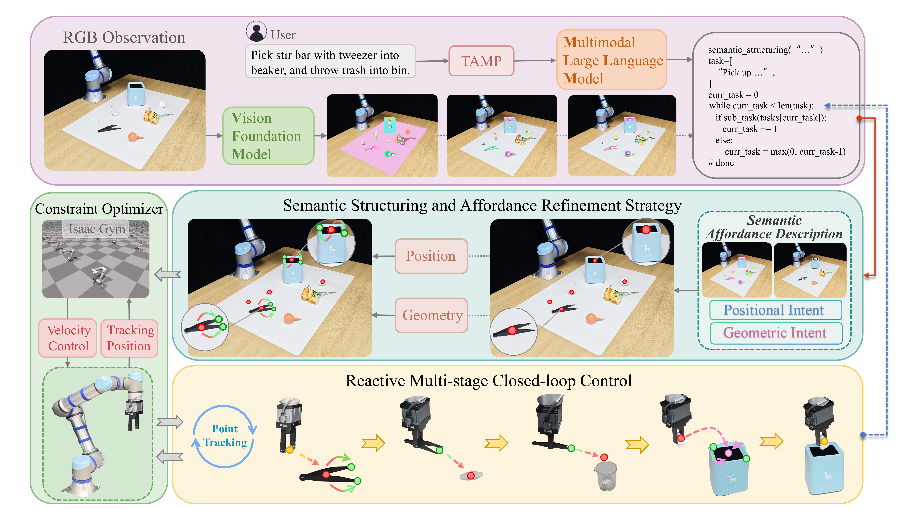

<h1 align="center">ReSemAct: Advancing Fine-Grained Robotic Manipulation via Semantic Structuring and Affordance Refinement</h1>

<p align="center">
  <a href="https://resemact.github.io/"></a>
  <a href="https://arxiv.org/abs/2507.18262"></a>
  <a href="https://github.com/scy-v/ReSemAct"></a>
  <a href="https://github.com/scy-v/ReSemAct/blob/main/LICENSE"></a>
</p>

<p align="center">
  
</p>

---

## 🛠️ Environment

- **OS**: Ubuntu 20.04  
- **CUDA**: 12.2  
- **NVIDIA Driver**: 535.161.07  
- **Conda Environments**:  
  - `ReSemAct` (Client)  
  - `m3p2i-aip` (Server)  

---

## 🔧 Client Setup (`ReSemAct`)
### 1. Create Conda Environment

```bash
conda create -n ReSemAct python=3.10 
conda activate ReSemAct
```

### 2. Install [OmniGibson](https://behavior.stanford.edu/omnigibson/getting_started/installation.html)

Install from source (editable mode), version `v1.1.0`:

```bash
git clone -b v1.1.0 https://github.com/StanfordVL/BEHAVIOR-1K.git
cd BEHAVIOR-1K/
```

Install OmniGibson:

```bash
pip install -e .
python -m omnigibson.install
```

### 3. Test Installation

```bash
cd <BEHAVIOR-1K_folder>
python -m omnigibson.examples.robots.robot_control_example --quickstart
```

### 4. Clone the ReSemAct Repository

```bash
git clone https://github.com/scy-v/ReSemAct.git
```

### 5. Install FastSAM and Download Weights

```bash
cd ReSemAct
git clone https://github.com/CASIA-IVA-Lab/FastSAM.git
```

### 6. Install Additional Dependencies
```bash
pip install -r requirements_client.txt
```
---

## 🖥️ Server Setup (`m3p2i-aip`)

### 1. Clone the [m3p2i-aip](https://github.com/tud-amr/m3p2i-aip.git) Repository and Create Environment

```bash
cd <ReSemAct_folder>
git clone https://github.com/tud-amr/m3p2i-aip.git
conda create -n m3p2i-aip python=3.8
conda activate m3p2i-aip
```

### 2. Install Isaac Gym

Follow the [prerequisites guide](https://github.com/tud-amr/m3p2i-aip/blob/master/thirdparty/README.md), download Isaac Gym from NVIDIA:[https://developer.nvidia.com/isaac-gym](https://developer.nvidia.com/isaac-gym)

Move and install Isaac Gym:

```bash
mv <Downloaded_Folder>/IsaacGym_Preview_4_Package <ReSemAct_folder>/m3p2i-aip/thirdparty/
cd <ReSemAct_folder>/m3p2i-aip/thirdparty/IsaacGym_Preview_4_Package/isaacgym/python
pip install -e .
```

### 3. Install `m3p2i-aip`

```bash
cd <ReSemAct_folder>/m3p2i-aip
pip install -e .
```

### 4. Install Additional Dependencies

```bash
cd <ReSemAct_folder>
pip install -r requirements_server.txt
```

---

## 🚀 Running the Demo

You need two terminals: one for the **server** and one for the **client**.

### 1. Start the Server

```bash
cd <ReSemAct_folder>
python mppi_server.py
```

### 2. Run the Client
Before running, set your OpenAI API key by either:
```bash
export OPENAI_API_KEY="your_api_key_here"
```
or add it to `configs/omnigibson_config/config.yaml.` Then start running with:
```bash
cd <ReSemAct_folder>
python run.py [--load_cache] [--visualize]
```

- `--load_cache`: Load pre-generated GPT-4o cache  
- `--visualize`: Enable visual debugging

---

## ⚡Known Issues
1. When the Franka robot grasps the object, an error may sometimes occur at the moment of contact, causing the sticky grasp mode to fail and the object to slip out of the gripper.
<p align="center">
  
</p>
<p align="center">
  
</p>

2. Due to simulation limits (`execute_action`), the robot’s optimization and execution run at a low frequency (`~6 Hz`). If the robot struggles to reach the target pose, please adjust threshold or deploy in a real environment.

---

## 🔑 Acknowledgments

- **Simulation Environments**  
  The simulation environments are based on [OmniGibson](https://behavior.stanford.edu/omnigibson/getting_started/installation.html) and [Isaac Gym](https://developer.nvidia.com/isaac-gym).

- **Language Model Integration**  
  The extension of Language Model Programs (LMPs) is built upon [Voxposer](https://voxposer.github.io/) and [Code as Policies](https://code-as-policies.github.io/).

- **Motion Planning**  
  The Model Predictive Path Integral (MPPI) algorithm implemented on Isaac Gym is adopted from [m3p2i-aip](https://autonomousrobots.nl/paper_websites/m3p2i-aip).

- **Code Snippets Reference**  
  Part of the environment code is adapted from the [ReKep](https://rekep-robot.github.io/) project.


---

## 📝 Citation

```bibtex
@article{su2025resemact,
  title   = {ReSemAct: Advancing Fine-Grained Robotic Manipulation via Semantic Structuring and Affordance Refinement},
  author  = {Su, Chenyu and Shang, Weiwei and Qian, Chen and Zhang, Fei and Cong, Shuang},
  journal = {arXiv preprint arXiv:2507.18262},
  year    = {2025},
  url     = {https://arxiv.org/abs/2507.18262}
}
```
